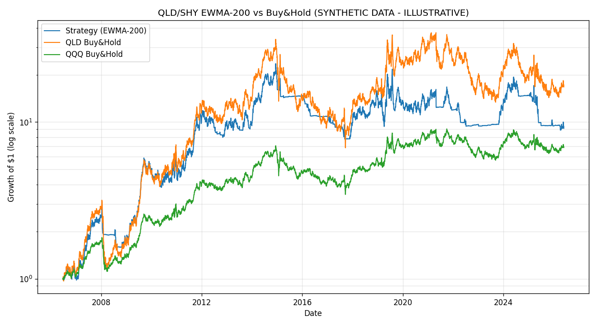
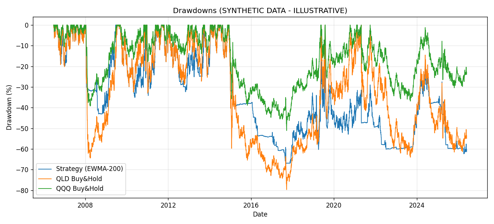

# QLD/SHY EWMA-200 Regime-Switch Backtest — Report

> **⚠️ DATA CAVEAT — READ FIRST.** This execution environment had no network access to any market-data provider (Yahoo, Stooq, AlphaVantage, Nasdaq are all blocked by the sandbox network policy), and no current total-return series for QLD/SHY/QQQ was available from the reachable hosts. The numbers below were therefore generated from a **seeded synthetic dataset** that reproduces realistic Nasdaq-100 dynamics (volatility regimes, leverage decay via true 2x daily-rebalance mechanics, a low-vol bond leg). **They are ILLUSTRATIVE of the methodology, not investment conclusions.** To obtain real figures, run in an environment with network access (or drop a `data/cache/prices.csv` with columns NDX,QQQ,QLD,SHY) and re-run:
>
> ```bash
> python run_backtest.py
> ```
>
> The code path, costs, no-look-ahead execution and metrics are identical regardless of data source.

## 1. Summary

A long-only trend-following overlay that holds the 2x Nasdaq-100 ETF **QLD**
when the Nasdaq-100 is in an uptrend and rotates to the short-Treasury ETF
**SHY** when it is not. The trend is the **EWMA-200** (span=200, α=2/201) of the
**signal instrument** — the Nasdaq-100 index (`^NDX`, or QQQ adjusted-close as a
proxy). The signal is deliberately *not* computed on QLD, so leverage decay
cannot distort the trend estimate.

- **Data source for this run:** `synthetic` (synthetic=True)
- **Period:** 2006-06-21 to 2026-05-29 (5203 trading days)
- **Signal:** EWMA-200 on NDX/QQQ total-return close
- **Rule:** close > EWMA → hold QLD; close ≤ EWMA → hold SHY (boundary = risk-off)
- **Execution:** signal at T close, position applied on **T+1** (no look-ahead)
- **Costs:** 0.03% fee + 0.05% slippage per side, charged on
  both legs of a switch (0.16% round-trip)

### Headline (strategy vs QLD buy-and-hold)

| Metric | Strategy EWMA-200 | QLD Buy&Hold |
| --- | --- | --- |
| CAGR | 11.73% | 15.19% |
| **Max Drawdown** | **-67.03%** | **-79.71%** |
| Calmar | 0.18 | 0.19 |
| Sharpe | 0.49 | 0.54 |
| Sortino | 0.49 | 0.54 |
| Ann. Vol | 34.00% | 42.19% |
| Time in market | 62.96% | 100% |
| Switches | 201 | 0 |

The central thesis of trend-timing a leveraged ETF is **drawdown control**: a 2x
ETF can lose the vast majority of its value in a deep bear market (path-dependent
decay compounds the loss), so sitting in cash-like SHY during downtrends is meant
to convert an un-investable max-drawdown into a tolerable one — ideally without
sacrificing all of the upside.

## 2. Full performance table

| Series | CAGR | MDD | Calmar | Sharpe | Sortino | AnnVol | TotalReturn | Exposure | Switches |
| --- | --- | --- | --- | --- | --- | --- | --- | --- | --- |
| Strategy (EWMA-200) | 11.73% | -67.03% | 0.18 | 0.49 | 0.49 | 34.00% | 812.84% | 62.96% | 201 |
| QLD Buy&Hold | 15.19% | -79.71% | 0.19 | 0.54 | 0.54 | 42.19% | 1578.03% | 100.00% | 0 |
| QQQ Buy&Hold | 10.16% | -51.13% | 0.20 | 0.55 | 0.55 | 21.10% | 588.14% | 100.00% | 0 |
| SHY Buy&Hold | 1.85% | -2.88% | 0.64 | 1.40 | 1.48 | 1.27% | 44.03% | 0.00% | 0 |

*MDD is the core metric. Calmar = CAGR / |MDD|. Sharpe/Sortino use rf=0,
annualised by √252. AnnVol is annualised daily-return volatility. "Switches" is
the number of executed regime changes (each charged round-trip).*

## 3. Charts





## 4. Robustness

| Series | CAGR | MDD | Calmar | Sharpe | Sortino | AnnVol | Exposure | Switches |
| --- | --- | --- | --- | --- | --- | --- | --- | --- |
| EWMA span=150 | 7.61% | -72.88% | 0.10 | 0.38 | 0.38 | 33.65% | 62.19% | 241 |
| EWMA span=200 | 11.73% | -67.03% | 0.18 | 0.49 | 0.49 | 34.00% | 62.96% | 201 |
| EWMA span=250 | 12.53% | -59.08% | 0.21 | 0.50 | 0.50 | 34.47% | 63.77% | 147 |
| SMA window=200 | 10.61% | -69.27% | 0.15 | 0.46 | 0.46 | 32.74% | 57.74% | 175 |
| EWMA-200 buffer=+/-0% | 11.73% | -67.03% | 0.18 | 0.49 | 0.49 | 34.00% | 62.96% | 201 |
| EWMA-200 buffer=+/-1% | 10.17% | -64.89% | 0.16 | 0.45 | 0.44 | 34.15% | 62.98% | 87 |

- **Span sensitivity ({150,200,250})** — shorter spans react faster (fewer deep
  drawdowns but more whipsaw/switches and cost drag); longer spans lag. A result
  that only works at one exact span is overfit; we report all three.
- **EWMA vs SMA** — EWMA weights recent prices more and turns slightly faster
  than the equal-weight SMA at the same length; compare switch counts and Calmar.
- **±1% buffer band** — a symmetric hysteresis band around the trend suppresses
  whipsaw: it should reduce the switch count (and cost drag) at the price of
  slightly later entries/exits. Compare the `buffer=0%` vs `buffer=±1%` rows.

## 5. Assumptions

1. **Total-return data.** All legs use dividend-reinvested adjusted close, so SHY
   coupons and ETF distributions are captured (see tax caveat below).
2. **T+1 execution via close-to-close TR.** Adjusted-close series have no
   adjusted *open*, so the spec's "T+1 open" rebalance is implemented as applying
   the new position to T+1's total return. This is the standard close-based
   convention and is verified look-ahead-free by tests.
3. **Costs.** 0.03% commission + 0.05% slippage per side,
   both legs per switch. No bid/ask modelling beyond slippage, no market impact.
4. **No financing/borrow line items** beyond what is embedded in QLD's own NAV
   (its 0.95% expense ratio and swap financing are already in its price series).
5. **rf = 0** for Sharpe/Sortino. Using a positive T-bill rate would lower both
   modestly and is a documented choice.
6. **Determinism.** Data is cached; the synthetic fallback is seeded
   (`seed=42`). Re-runs are bit-identical.

## 6. Risks & caveats

- **Leverage path risk.** QLD resets 2x daily. In choppy, high-volatility
  sideways markets it bleeds even when the index ends flat; the strategy mitigates
  this only when the *trend* filter is out of the market, not during in-trend
  chop.
- **Whipsaw / regime cost.** Near the EWMA, frequent crossings generate switches;
  each round-trip costs 0.16% and taxes are extra. The
  buffer-band analysis quantifies this.
- **SHY foreign withholding tax (risk-off leg).** For a non-US (e.g. Taiwan)
  investor, SHY distributions are US-source and subject to **30% US withholding
  tax** (absent treaty relief). SHY is a *bond* ETF whose total return is almost
  entirely coupon income, so a 30% haircut on distributions is a direct, material
  drag on the risk-off leg — unlike an equity ETF where most return is price
  appreciation. The more time the strategy spends in SHY (high "time-out-of-market"
  in prolonged bears), the larger this tax leakage. Mitigations to consider:
  a local money-market/short-bond fund, treaty-rate reclaim, or holding cash.
- **Single-regime / overfitting risk.** Most of the sample is one secular tech
  bull market. Parameter robustness is reported, but out-of-sample / different
  regimes (e.g. a prolonged rising-rate bear) could behave differently.
- **Survivorship & product risk.** QLD/SHY are specific products; expense ratios,
  swap counterparties, and index methodology can change.

## 7. Reproduce

```bash
pip install -r requirements.txt
pytest -q                 # all tests must pass
python run_backtest.py    # real data if network/cache available; else synthetic
python run_backtest.py --synthetic   # force the seeded illustrative dataset
```
